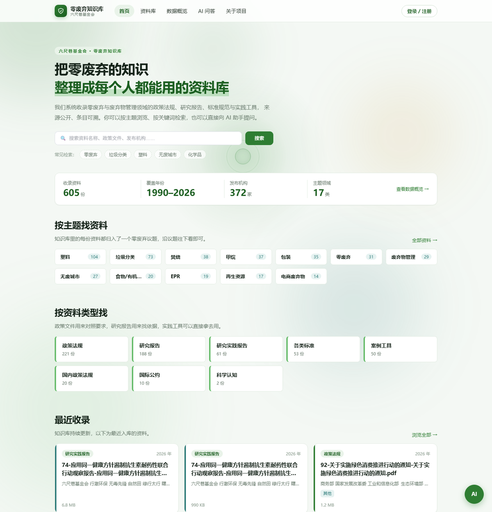
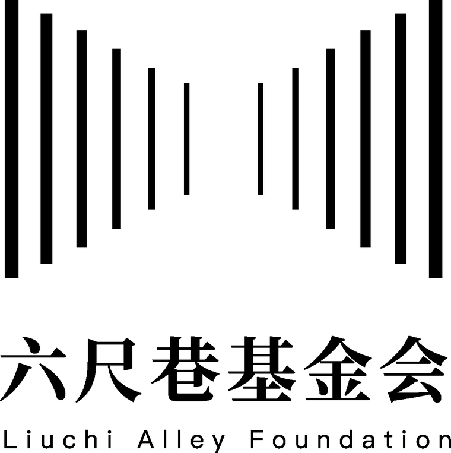
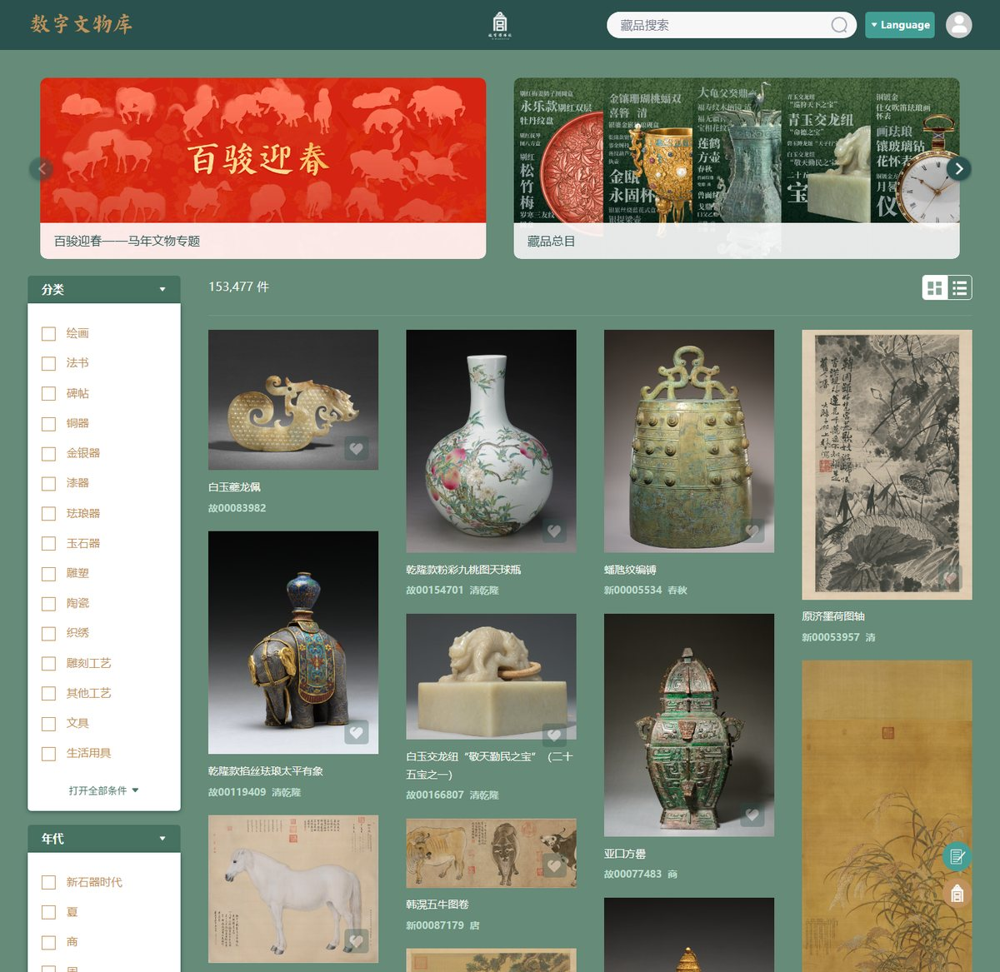
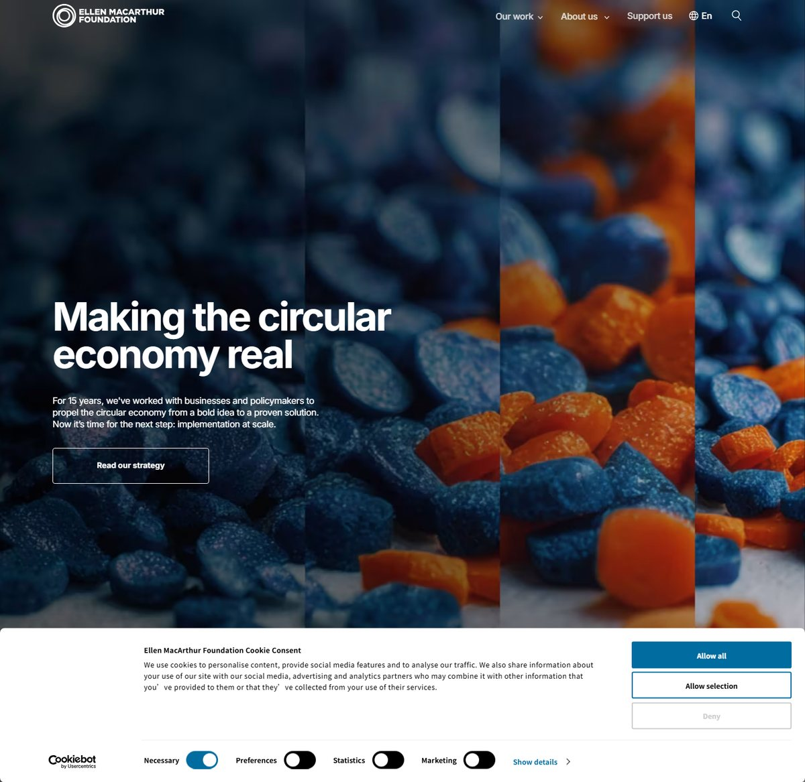
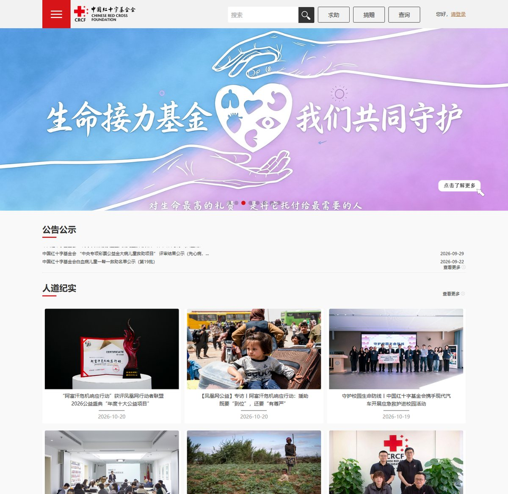
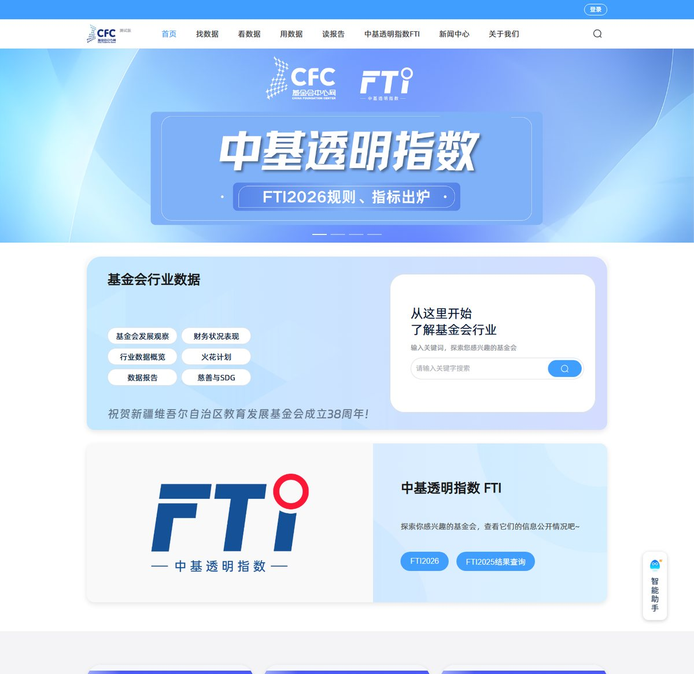

# 基金会主题 UI 重设计 · 调研与方案

> 日期：2026-10-20　　范围：只调研 + 出方案，**未改任何代码**
> 调研：国内 16 站 + 国际 14 站，共 30 个站实读；参考资料截图在 `docs/refs-ui-2026-10-20/`

---

## 0. 一句话结论

现在的知识库站是**"零废弃绿工具站"**，基金会官网是**"红色模板站"**（`#F13A3A`），两套语言互不相干——外面看像两个机构。
建议做 **A 案「墨绿为骨 · 宋体为面 · 黑白为徽 · 朱红一点」**：保留现有绿令牌体系（改 1 个文件即可换肤），换上基金会官方的黑白宋体 logo 与衬线标题，把首页从"只讲零废弃"改成"基金会 5 大工作领域 + 知识库"的复合骨架，分 3 个阶段落地。

**需要小志拍板的 4 个问题在第 7 节**，拍板后我再动代码。

---

## 1. 现状体检：现在的站长什么样

> 注：这是**线上旧版演示**（`summer-camp-h5.app.workbuddy.host`，导航 5 项：首页/资料库/数据概览/AI问答/关于项目）。本地 `HomeView.vue` 已经是新版（hero + 4 块），但两者不是一回事，评审时别拿旧版当现状。

### 1.1 设计系统现状（换肤主战场 = `frontend/src/styles/global.css` 的 `:root`）

| 项 | 现状 |
|---|---|
| 主色 | `--zw-green:#2e7d32`（Material 绿，偏工具/APP） |
| 深绿/浅绿 | `#1b5e20` / `#66bb6a` / `#6fbf73` / `#12331a` |
| 底色 | `--zw-bg:#f4f8f4`（淡绿底）、`--zw-mint:#e9f3e9`、mint-2 `#f2f8f2` |
| 辅助色 | 琥珀 `#c8871f`、青 `#2b7a78`、危险红 `#c45656` |
| 文字 | 墨绿系 `#16241a` / `#2c3a2f` / `#66786a` / `#93a396` |
| 线 | `#e1ebe1` / `#cfe0cf` |
| 圆角 | 8 / 14 / 22 px，Element Plus `--el-border-radius-base:10px` → **整体偏圆润** |
| 阴影 | 三档绿调阴影 `rgba(22,36,26,…)` |
| 字体 | **全站无衬线**：`'PingFang SC','Microsoft YaHei',system-ui`，标题 700 + `letter-spacing:-0.01em`，正文 15px |
| 眉标 | `.zw-eyebrow` = 浅绿胶囊 chip（`border-radius:999px` + `letter-spacing:.16em` 大写英文） |
| 令牌化程度 | 全前端 `var(--zw-*)` 引用 **565 处**（muted 76 / faint 69 / green-deep 65 / line 59 / text 50 / green 48 …），**改 `:root` 就能一次性换肤** |

### 1.2 结构现状

- 导航 4 项：首页 / 资料库 / AI 问答 / 我要投稿（`SiteNav.vue`，sticky 磨砂条，桌面 64px；手机 ≤720px 换抽屉 + 底部常驻条）
- 品牌区：绿色渐变环状图标 `public/zero-logo.png` + 「零废弃知识库」+ 副标「六尺巷基金会」——**logo 是抽象 O 形，跟六尺巷/基金会没有任何关系**
- 首页 4 块：项目简介+合作与共建 / 关于基金会（宗旨 + 5 条核心方向）/ 资料分布横条图 / 引用与转载
- 资料库页：h1 → 工具条（主题 tag、资料类型、更多筛选含机构/年份/排序）→ 资料卡列表
- AI 问答页：欢迎态「Hi，我是零废弃助手」→ 输入区 → 右侧引用抽屉

### 1.3 体检结论：7 个问题

| # | 问题 | 证据 | 影响 |
|---|---|---|---|
| 1 | **机构身份缺位**：logo 跟基金会无关，基金会只是副标一行 | `zero-logo.png` 绿色渐变环 | 别人看不出这是谁家的站 |
| 2 | **"复合"没做出来**：基金会真实有 5 大工作领域，站点只讲零废弃（+ 部分化学品与健康） | 官网「工作专栏」5 领域；我们只有 603 份覆盖前 2 个 | 机构宽度没体现，只像个专项工具站 |
| 3 | **气质对不上**：官方 logo 是宋体 + 拉字距英文，我们全站无衬线圆角 | 官方 logo（见下） | 两边不像一家人 |
| 4 | **圆润 + 胶囊 + 淡绿底** = SaaS 工具审美，不是公益机构 | radius 8/14/22、eyebrow 胶囊、bg #f4f8f4 | 机构感弱，商业感强 |
| 5 | **没有信任背书位**：注册号/备案号/审校口径/来源与授权全缺 | 国际站 8/8 都有（EMF 页脚注册号、Gates 数字口径、Wikimedia Photo credits） | 资料型站点最看重"能不能放心用" |
| 6 | **首页没有"机构入口"**：没有工作领域、没有信息公开、没有"关于我们"独立页 | 导航只有 4 项 | 机构身份无处落地 |
| 7 | **装饰性动效**（`MouseGlow` 光标光环、渐变）偏"AI 通用审美" | 组件列表 | 与"礼让自然"的克制叙事冲突 |

---

## 2. 基金会品牌事实（必须对齐的东西）

### 2.1 官方 logo（我们最该用的品牌资产）

**纯黑白、无彩色**。上方是由竖直线条构成的抽象图形（屋檐／门楼／巷道／"三尺"间距的负空间意象），下方是**宋体「六尺巷基金会」** + 拉大字距英文 `Liuchi Alley Foundation`。

> 关键推论：官方 logo 本身**不用红色**。官网的红是凡科建站模板给的，不是基金会选的品牌色。所以"我们用绿"和"他们用红"之间**不存在品牌冲突**，红是模板色，绿（环保）反而更贴"礼让自然"。这为 A 案提供了合法性。

### 2.2 官网现视觉与信息架构

- 主题 CSS（`jzs.508sys.com/843/fkTheme.min.css?aid=33469028`）主色 **`#F13A3A` 出现 341 次**、`#E4393C` 27 次、白 75 次 + 一堆灰阶；HTML 里另有 `#324D52`、`#AED7E0`。→ **典型凡科红模板站**
- 导航：首页 / 关于我们 / 信息公开 / 工作专栏
  - 关于我们 → 机构简介 · 理事会和监事会 · 团队成员 · 党建活动 · 联系我们
  - 信息公开 → 机构章程 · 规章制度 · 工作报告 · 审计报告 · 专项信息审核报告 · 机构年报
  - 工作专栏 = **5 大领域**：零废弃 / 化学品安全与健康 / 行业赋能 / 绿色标准与认证 / 文化传承
- 首页：轮播 banner → 使命愿景 → 工作领域图标入口 → 最新资讯列表 → 联系我们 → 公众号二维码页脚
- 机构实情：**1-10 人微机构、无公募资格、无税前扣除资格**、域名已备案（皖ICP备2025104469号-1）
- 官网 PDF 下载被 WAF 拦截（返回「抱歉，您的访问疑似攻击请求，已被系统自动拦截」），只拿到 HTML/CSS

### 2.3 我们的真实资产

- 603 份资料（零废弃 480 + 化学品与健康 123）· 17 个主题 · 372 家发布机构 · 覆盖年份 1990-2026（首页数字均为实时取数）
- 机构自己承认的短板（田倩说明会原话）："知识库的**前端页面和操作路径待优化**"、"下载和 AI 助理需加入钉钉才能用、暂无法对外"
- 我们的差异化：**国内几乎没有公益机构真的做"可检索的真资料库 + AI 问答"**（见第 3 节 B4）

---

## 3. 参考站清单（30 站，每条只留一个"可抄点"）

### 3.1 国内 16 站

| 站点 | 定位 / 主色 | 可抄的一点 |
|---|---|---|
| [红十字会基金会](https://www.crcf.org.cn/) | 全国公募 · 红 `#E60012` | 首页「财务三数字 + 项目类目计数」（139.59 亿 / 救助 700 万人）——**数字条是标配** |
| [乡村发展基金会](https://www.cfrd.org.cn/) | 乡村文化振兴 · 橙红 `#F60` | 捐款总额计数器 + 侧栏「项目信息公开 / 年度审计报告」小卡 |
| [妇女发展基金会](https://www.cwdf.org.cn/) | 妇联系统 · 玫红 `#C8102E` | 「上一年度募资 4.97 亿」把**口径写进数字** |
| [青少年发展基金会](https://www.cydf.org.cn/) | 希望工程 · 蓝+黄麦穗 | 捐赠通道三卡（个人 / 机构 / 月捐）——**转化路径独立成块** |
| [中国绿化基金会](https://www.cgf.org.cn/) | 林草口 · 森林绿 `#2E7D32` | 资料披露做「项目起止日期」（2014-11-14 至 2027-12-31）；捐赠动态 = 捐赠人+金额+项目+时间 |
| [支付宝公益](https://love.alipay.com/) | 平台型 · 蓝 `#1677FF` | 项目卡固定「项目名 + 发起基金会 + N 人捐 + 已募 + 长期有效标签」 |
| [字节跳动公益](https://gongyi.bytedance.com/) | 公司型 · 黑白无主色 | **方向 → 子项两层结构**（唯一做对的层级：乡村发展下含山货上头条等） |
| [腾讯公益](https://gongyi.qq.com/) | 平台型 · 腾讯蓝 | 公众端极简、只留"机构登录"，把公众筹款让给微信 |
| [南大教育发展基金会](https://njuedf.nju.edu.cn/) | 高校基金会 · 南大紫 `#702082` | **机构形象官网范式最完整**：栏目用「中文大标题 + 英文小字」两行左对齐 |
| [浙大校友总会](https://zuaa.zju.edu.cn/) | 高校 · 浙大蓝 `#003F88` | 刊物 PDF 用「封面缩略图 + PDF 角标」呈现 |
| [故宫博物院](https://www.dpm.org.cn/) | 博物馆 · 藏红 `#A4322E` | 「藏品 **1,863,404**」巨型数字 + 三张数据库入口图 |
| [故宫数字文物库](https://digicol.dpm.org.cn/) | **资料库检索范式** | 左筛选（25 类 / 21 朝代 / 色卡）+ 右网格 + 顶部计数（见下图） |
| [中国数字科技馆](https://www.cdstm.cn/) | 科技馆 | 「栏目即 IP」原创内容推荐，每栏 = 封面 + 标题 + 一句 |
| [基金会中心网](https://www.foundationcenter.org.cn/) | 行业数据平台 | 首页**大搜索框** + 「中基透明指数 FTI」专栏 |
| [公益时报](http://www.gongyishibao.com/) | 行业报纸 | 「慈善智库」把政策/报告/人物做成栏目；大额捐赠实时榜 |
| [清华公益慈善研究院](https://www.givingchina.org/) | 捐赠研究 | 年度 PDF 免费查阅 + 报告订阅 |

失效站（不要照抄）：`gf.org.cn`（域名售卖页）、`ipe.org.cn`（空壳）、苏州大学教育基金会旧站（已换成统一缴费平台）。

### 3.2 国际 14 站

| 站点 | 定位 / 主色 | 可抄的一点 |
|---|---|---|
| [Ellen MacArthur](https://www.ellenmacarthurfoundation.org/) | 循环经济 · 墨绿+米白 | 全站只一个 `/explore`，**筛选状态写进 URL** |
| [Mozilla Foundation](https://www.mozillafoundation.org/) | 开放互联网 · 黑白 + 9 辅色 | Hero = 3 段折叠面板；社区人物卡（头像+角色+引语） |
| [Wikimedia](https://wikimediafoundation.org/) | 自由知识 · 蓝白 | 页面最底部完整 **Photo credits（署名 + 许可）** |
| [Charity Navigator](https://www.charitynavigator.org/) | 慈善评级 · `#234ae0` | Hero = 搜索框 + AI 搜索入口；统计条 25+/8M+/245K+ |
| [Ocean Conservancy](https://oceanconservancy.org/) | 海洋保护 | 捐赠块旁 17 个赞助 logo 墙 + 501(c)(3) 声明 |
| [Ford Foundation](https://www.fordfoundation.org/) | 资助型 | 9 张议题专属拼贴卡；报告 PDF 为主 |
| [OSF](https://www.opensocietyfoundations.org/) | 开放社会 | 数字与一句解释**交替排**（不是数字堆） |
| [Gates](https://www.gatesfoundation.org/) | 全球健康 | 数字上方写"截至 2025 年 12 月 31 日止年度"——**口径压数字上方** |
| [Candid](https://candid.org/) | 公益数据 | 每个数字下配一句解释；Seal of Transparency 徽章 |
| [Project Drawdown](https://drawdown.org/explorer) | 气候方案库（最贴题） | 卡片固定「分类 + 数值区间 + **见效速度**」；双下拉筛选 + 空态人话 |
| [Zero Waste Europe](https://zerowasteeurope.eu/) | 零废弃欧洲 | 5 步分段叙事 + Resources 三分类 |
| [Library of Congress](https://www.loc.gov/) | 数字档案馆 | **Top Searches 词 chip 直喂搜索** |
| [ZWIA](https://zwia.org/) | 零废弃标准 | 编号标准清单（标注 est.2004 / updated 2018）+ 主题目录，**不用卡片墙** |
| [GlobalGiving](https://www.globalgiving.org/search/) | 众筹库 | 双维筛选且**每项带实时计数**（Education 3,649 / China 40） |

---

## 4. 跨站规律（10 条，可以直接落成 CSS 规则的）

1. **底色近白/浅中性，1 个品牌主色扛信任**，高饱和只做状态和点缀。1% for the Planet 用中性纸感 `#E6D8AE`/`#C0D9CB` 当"桥"来中和蓝色；Mozarila 主色纯黑白，9 辅色只做点缀。
   → **对六尺巷**：绿是唯一主色；宣纸米白当"桥"；朱红只留给"支持我们"一个动作。
2. **正文无衬线，衬线只上大字标题/引语**（EMF 的 Bookmania"仅用于标题和 pull-quotes"、Ford 的 Meursault 做 headline）。
   → 中文对应：正文思源黑体 16px/1.8；**大标题换成宋体/衬线**（呼应官方 logo 的宋体）。
3. **Hero 五型**：①大标语+单 CTA ②多段面板 ③横幅图卡 ④全幅影像+Donate ⑤分步叙事。公益站首选 ① 或 ⑤。
   → 我们用 ①：**一句话定位 + 一个主 CTA + 一个可验证数字**。
4. **数字三件套**：数字 + 单位后置 + **一句口径**。Gates 把"截至 2025-12-31 止年度"写在数字上方；Candid 每个数字下配解释。
   → 我们所有"累计/年度"数字必须标截止时间与统计口径。
5. **资料用目录/编号清单承载，首页精选才用卡片**（ZWIA 标准清单、Ford 议题卡是两回事）。
6. **资料库 = 单一端点 + 筛选写进 URL**（EMF `/explore?sortBy=dateDesc&topics=Plastics`，显示"1448 results / Showing 20 of 1448"）。
   → 我们只做一个 `/shelf` 路由，筛选可分享、可回溯。
7. **筛选每项带实时计数**（GlobalGiving、EMF）。
8. **信任背书贴三处**：钱（页脚注册号 + 捐赠块旁 logo 墙）、数据（口径说明）、授权（图片署名 + 许可）。
9. **热门检索词 chip 直接喂 AI 问答**（LOC Top Searches）——我们的 AI 问答本来就是主打，可以做成闭环。
10. **空态写人话**："没有符合条件的资料，试试放宽筛选"（Drawdown）。
    → 中式排版补充：正文 **16px 起、行高 1.75-1.9**（国内公益站普遍 14px/1.4，偏挤）；数字用 `tabular-nums`；**禁用斜体**（中文伪斜体发虚）；标题必须做避头尾；装饰性大写英文（ABOUT US）不稳，通行做法是「中文大标题 + 英文小字」两行左对齐。

---

## 5. 三个候选方向

### A 案（推荐）墨绿宋体 · 文化机构风

| 层 | 具体值 |
|---|---|
| 底 | `--zw-bg:#f6f4ee` 宣纸米白、`--zw-surface:#fff`、`--zw-mint:#eaf0ea` |
| 主色 | `--zw-green:#2a6045` 墨绿（绿里带青，压住 Material 绿的"APP 感"） |
| 绿阶 | deep `#173a2a` / light `#6e9c7e` / soft `#7fa98d` / ink `#0e241a` |
| 点缀 | `--zw-gold:#a8792e`（暖金，替代现在的琥珀）+ `--zw-seal:#b23a32`（印泥红，**只给"支持我们"**） |
| 文字 | ink `#1b1f1d` / text `#33383a` / muted `#6b7275` / faint `#9aa1a4`（改中性，脱离绿味） |
| 线 | `#e5e0d5` / `#d3ccbc`（纸线，不是绿线） |
| 形 | radius 4 / 8 / 12（**从圆润改方正**），Element Plus base 改 4px；阴影几乎不用，改 1px 线分隔 |
| 字 | 正文 `'PingFang SC','Microsoft YaHei'`；**标题新增衬线栈** `'Noto Serif SC','Source Han Serif SC','Songti SC','SimSun',serif`（系统栈优先，不引 10MB 字体包） |
| logo | 换基金会官方黑白 logo（需机构授权确认） |

- 首屏：衬线大标题「把零废弃与化学品安全的知识，整理成每个人都能用的资料库」+ 一行副题 + 主 CTA「查资料」+ 次 CTA「问 AI」；右不放花哨大图
- 导航 6 项：首页 / 我们的工作 / 知识库 / AI 问答 / 信息公开 / 关于我们（+「我要投稿」按钮 + 登录）
- 优：机构气质出来、logo 对得上、换肤成本低（只改 `:root`）
- 劣：视觉更大胆，需要基金会拍板认这套"素"；宋体在移动端渲染略旧
- 工作量：换皮 ~1 天，骨架 ~2-3 天，补齐 ~2 天

### B 案 延续官网红（`#F13A3A`）

- 优：与现官网无缝、外部认得出
- 劣：**红是凡科模板色不是基金会品牌色**（官方 logo 纯黑白）；红 + 飘带 + 黄星是典型政务公益感（cn 调研里最该避开的那种）；与"环保/礼让自然"语义相冲；565 处令牌全换色，回归风险大
- 判断：**不建议**，除非基金会明确要求"两站必须一模一样"

### C 案 绿底微调（最省）

- 保留 `#2e7d32` 全套值，只加衬线标题 + 黑白 logo + 一个印章红
- 优：改动最小，一天内可见效
- 劣：底色还是淡绿、圆角还是 14px、"复合"还是没做出来 —— **只解决 logo 和字体两个表层问题**
- 判断：可作为 A 案的**阶段 0 兜底**

---

## 6. 推荐落地（A 案，三阶段）

### 阶段 1 · 换皮（只动 `global.css` + logo，~1 天）

- `:root` 重定义（上表全部值），同步 9 个 `--el-color-*` 变量
- 新增 `--zw-serif` / `--zw-gold*` / `--zw-seal` / `--zw-paper`
- 字体栈：标题类统一 `var(--zw-serif)`；正文 15px→16px、行高 1.75
- 圆角/阴影/眉标：胶囊眉标 → 方角细线眉标；阴影 → 线分隔
- `public/zero-logo.png` 换成基金会黑白 logo（或新增 `foundation-logo.png` 并改 `SiteNav.vue` 品牌区）
- **注意**：565 处 `var(--zw-*)` 引用不用动；页面里写死的颜色（`AdminStatsView` 曾用 `#c0392b` 等）要清一遍

### 阶段 2 · 骨架（`SiteNav.vue` + `HomeView.vue` + 新增 2 个页面，~2-3 天）

首页重排为 6 块：

1. **Hero**：衬线大标题 + 副题 + 主 CTA「查资料」/ 次 CTA「问 AI」+ 右侧低调大图（或纯排版）
2. **数字条**：603 份资料 / 17 个主题 / 372 家发布机构（**实时取数 + 口径注脚**）
3. **五大工作领域**（← "复合"落点）：零废弃 ✔ 有资料 · 化学品安全与健康 ✔ 有资料 · 行业赋能 / 绿色标准与认证 / 文化传承 → 标注"建设中"，给官网对应栏目外链
4. **知识库入口**：热门检索词 chip（LOC 式）→ 一点直接进检索
5. **机构信息**：宗旨「礼让自然」/ 愿景 / 成立时间 / 备案号 —— 全部事实陈述
6. **引用与转载 + 订阅/联系**（把公众号二维码做成"订阅资料更新"的正经模块，而不是贴纸）

新增页面：**我们的工作**（5 领域总览）、**信息公开**（章程/制度/年报/审计——先做占位索引，PDF 链接等基金会提供）

### 阶段 3 · 补齐可信度（资料库 + 详情页，~2 天）

- `/shelf` 单一端点 + 筛选写进 URL；筛选项带实时计数；空态写人话
- 资料卡固定字段：标题 + 类型 + 发布机构 + 年份 + **来源与授权**（对应 Wikimedia 的 Photo credits）
- 每个数字标注截止时间与统计口径
- 首页热门词 chip 直喂 AI 问答（LOC 式闭环）

### 明确不做

- 不改引擎、不改后端契约、不加假数据、不动 admin 视觉（后台保持工具感即可）
- 不引 10MB 级中文 webfont（用系统衬线栈 + 可选子集）
- 不把党建/时政塞进首页（国内站通病，我们机构小，不走那条路）

---

## 7. 需要小志拍板的 4 件事

1. **视觉方向**：A（墨绿宋体）／ A′（只做阶段 1）／ B（红）／ C（绿底微调）？
2. **logo**：能不能用基金会官方黑白 logo？需不需要机构书面确认？
3. **两站关系**：知识库是"基金会官网的一个板块"（要不要把官网工作专栏也迁进来），还是"基金会旗下独立的知识库站"？这决定导航 6 项怎么定。
4. **正文密度**：正文 15px → 16px/1.8（国内公益站普遍 14px，偏挤），换舒适度会降一点信息密度 —— 认不认？

---

## 附：调研方法与限制（诚实说明）

- 国内 16 站、国际 14 站**均为实际打开抓正文**；界面截图 4 张已存 `docs/refs-ui-2026-10-20/`
- 部分 HEX 为目测近似值（国际队本机 shell 禁网、抓不到 CSS 源码），落地前需自行取色；官网 `#F13A3A` 是**从 fkTheme.min.css 实测计数**（341 次），准确
- 抓取失败/未下结论：Europeana、Internet Archive、Wellspring、Patagonia（维护页）
- 基金会官网 PDF 资源被 WAF 拦截，只拿到 HTML/CSS
- 线上演示版是**旧版**（5 项导航），与本地 `HomeView.vue` 不一致，评审时以本地代码为准
- 本轮**未改任何代码**，只新增本文档与 `docs/refs-ui-2026-10-20/` 截图
