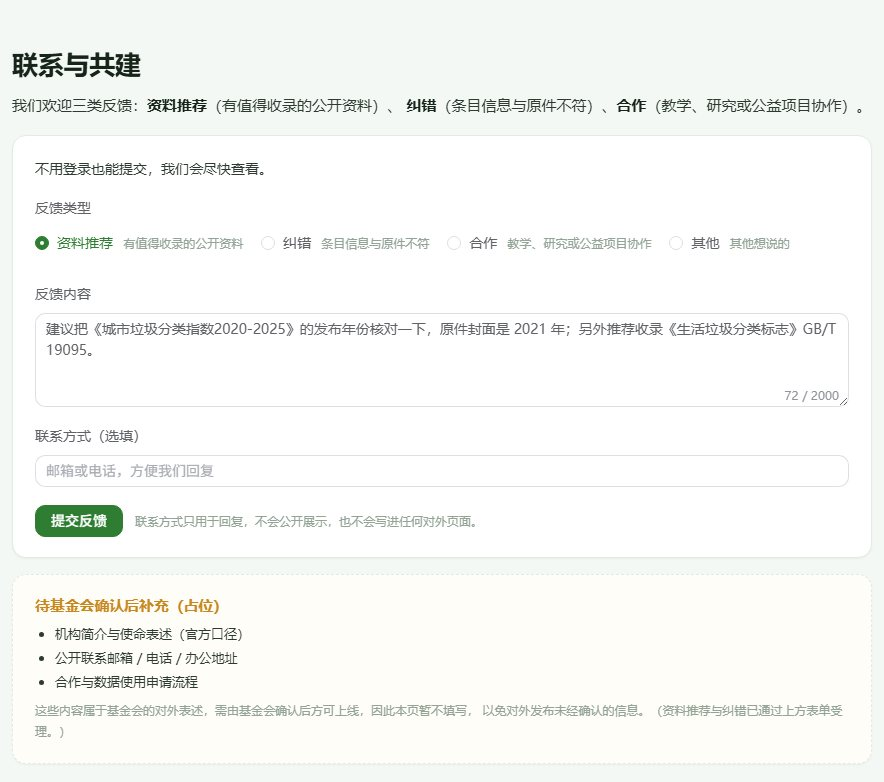
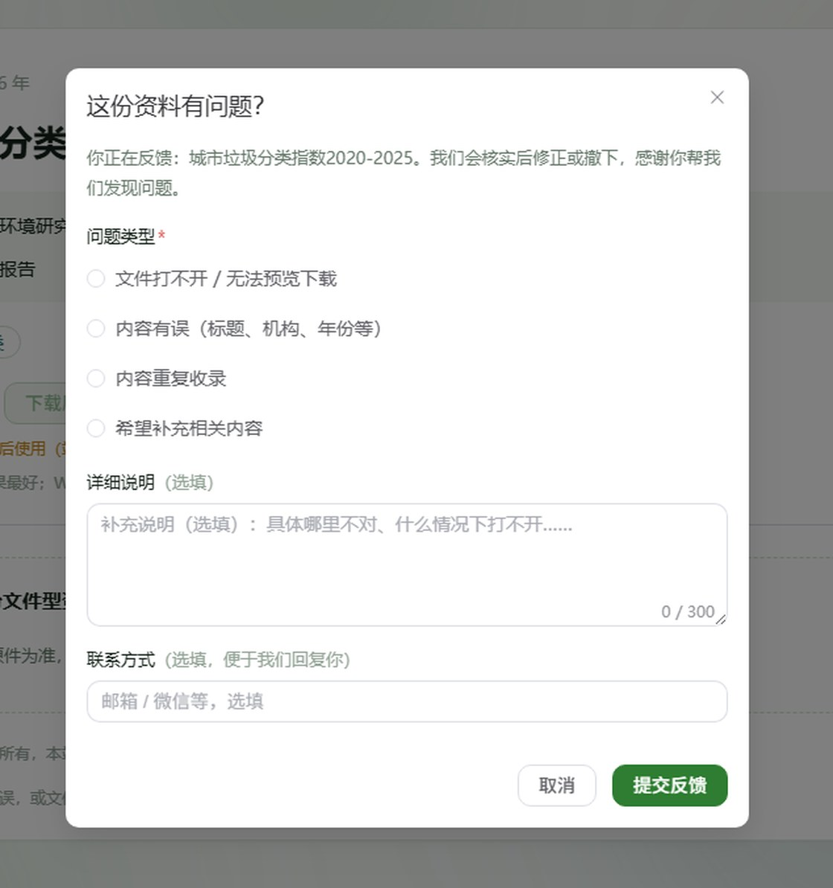
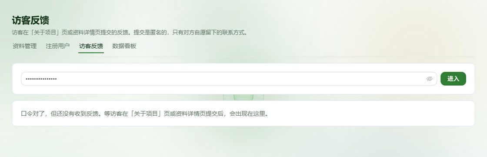

# 本轮改动说明 —— 数据导出 · AI 回复渲染 · 反馈闭环（2026-10-14）

> 起因：课程任务清单里「后端 · 数据导出」（署名瑞萍）与「AI · markdown 解释」（署名瑞泽）两块尚未落地。
> 动工前先按清单逐条核查了项目现状（第二节），确认「数据导出」是唯一的功能空白，另外两处是
> 「写了承诺没兑现」的缺口；一并补齐，并把顺路发现的问题修掉。
>
> 本文只写**实际改了什么、怎么验的、还剩什么要拍板**。所有结论性描述都对应仓库里的代码或一次真实运行。

---

## 一、结论速览

| # | 做了什么 | 状态 | 位置 |
|---|---|---|---|
| 1 | **数据导出**：后台 4 类报表导出为 CSV | 已完成并验收 | `backend/src/csv.ts`、`backend/src/routes/admin.ts` |
| 2 | **AI 回复 Markdown 渲染**：助手气泡按 Markdown 显示 | 已完成（**合并后改用远端实现**） | `frontend/src/components/ChatBubble.vue`（marked + DOMPurify，T5 已实现） |
| 3 | **访客反馈闭环**：提交表单 → 落库 → 管理页 → 导出 | 已完成并验收 | `backend/src/feedback/`、`routes/feedback.ts`、`FeedbackForm.vue`、`AdminFeedbackView.vue` |
| 4 | 顺手修的两处隐患 | 已完成 | 限流与校验的顺序、`.gitignore` 两条 |

验收方式不是「接口返回 200」，而是把响应体**按 CSV 真解析回来逐行断言**、把页面**用浏览器真点一遍**。
断言合计 **120 条**（32 + 52 + 36，见第四节；Markdown 那一组 38 条随实现作废、合并后另补 6 条闸 0 断言）。

---

## 二、任务单逐条对照（动工前的核查）

清单原样抄录，右侧是本轮动作。**「未动」不是遗漏，是刻意留着的**（理由见第六节）。

### UI

| 清单条目 | 现状核查 | 本轮 |
|---|---|---|
| 视觉层级设计 | 已有设计令牌体系 `frontend/src/styles/global.css`（`--zw-*`），已覆盖 Element Plus 主色 | 未动 |
| 前端功能：上传 | 已有（`POST /api/admin/knowledge/upload`） | 未动 |
| 前端功能：**反馈** | ❌ **只有一条 `feedback_submit` 埋点名躺在白名单里，全站没有提交入口** —— 那条埋点永远是 0 | ✅ 补全 |
| 前端功能：审核 / 生成路线 | 审核 = 后台资料管理；生成路线尚无此概念，属需求未定义 | 未动（需先明确是什么） |
| 前端功能：分享 | 已有（详情页「复制分享链接」） | 未动 |
| 前端功能：点赞 | 无。需要先决定「点赞给谁看」——访客点赞量对基金会有什么用？ | 未动（需先明确目的） |
| 资讯推荐页（可行性分析） | 已有 `/insights` 数据概览页（真实统计，非假数据） | 未动 |
| 设计规范（机构介绍/背景/联系方式） | 已有 `/about`，其中**机构对外口径一律留占位块，不编造** | 未动（等基金会给口径） |

### 后端

| 清单条目 | 现状核查 | 本轮 |
|---|---|---|
| 界面布局设计 | 已完成（对外 6 页 + 后台 4 页） | 未动 |
| 数据读取设计 | 已完成（`GET /api/docs`、`/facets`、`/overview`、三通道 `DOCS_SOURCE`） | 未动 |
| **数据导出** | ❌ **完全没有** —— 后台能看不能拿，老师要一份台账只能自己截图抄 | ✅ **本次主任务** |

### AI

| 清单条目 | 现状核查 | 本轮 |
|---|---|---|
| 回答优化 | 已有问答设置（模型 / 回答方式 / 思考强度，T3） | 未动 |
| RAG | 由 WeKnora 引擎负责，本站只做代理（三条铁律之一：不碰引擎源码） | 未动 |
| **markdown 解释** | ❌ **引擎回的是 Markdown，前端用纯文本插值显示** —— 用户看到的是 `**加粗**`、`- 列表` 原文 | ✅ 补全 |

### 「站在用户和管理老师的角度思考」

这条是清单里最像「提醒」而不是「任务」的一句。按它筛了一遍，两个角色各有一处说不通：

- **访客**：`/about` 写着「欢迎反馈」，但受理方式是占位块里的一条待办 —— 给了承诺没给入口。
- **管理老师**：如果反馈只做了接口不做页面，等于只收不读（老师不可能去 `curl`）。所以本轮
  反馈是**表单 + 落库 + 管理页 + 导出**四件一起做完的，缺一件这个功能都不成立。

---

## 三、四块交付的细节

### 3.1 数据导出（主任务）

**接口**（都在 `backend/src/routes/admin.ts`，统一需 `X-Admin-Token`，fail closed）：

| 接口 | 导什么 |
|---|---|
| `GET /api/admin/export/knowledge` | 资料台账全量（10 列） |
| `GET /api/admin/export/users` | 注册用户（7 列，手机号脱敏） |
| `GET /api/admin/export/stats` | 看板统计（4 列长表，14 天 × 6 指标 = 84 行） |
| `GET /api/admin/export/feedback` | 访客反馈（8 列） |

**CSV 三个必做要点**，都收在 `backend/src/csv.ts` 一份实现里（四类导出共用，避免转义规则出现第二份）：

1. **UTF-8 BOM** —— 不带的话 Excel 在简体中文 Windows 上按 GBK 解，中文全变乱码；
2. **字段转义** —— 含 `,` `"` 换行的字段用双引号包裹并 `""` 转义；
3. **公式注入防护** —— 以 `= + - @` 开头的单元格前缀单引号。反馈是**访客可控文本**，
   这条不做的话，一条 `=1+1` 的反馈被导出打开就会在管理老师机器上求值。

> ⚠️ 第 3 条要排除纯数字（`-3`、`-2.5` 不该被加引号变成文本），实现里用 `PURE_NUMBER` 正则区分。

**前端**：后台各页加导出按钮（资料管理页的放在「上传资料」之前 —— 导出是更高频的动作）。
文件名由**前端**拼，因为本地开发时前后端跨域，浏览器默认不暴露 `Content-Disposition`。

**为什么不对访客开导出**：`/about` 已写明「如需批量获取或用于教学，请见联系与共建」，
对外开批量导出一是与对外口径冲突，二是容易被爬。这一条写进了 `docs/接口约定.md`。

### 3.2 AI 回复 Markdown 渲染

引擎回的是 Markdown，此前 `HomeAskWidget.vue` 用纯文本插值，用户看到的是标记原文。

> **⚠️ 合并后本节结论已变更（2026-10-14 晚）**：主控分支在同一时间独立实现了同一件事 ——
> T5 把渲染抽成了 `ChatBubble.vue`，用成熟的 `marked` + `DOMPurify`。**同一件事不留两份实现**，
> 故合并时**让路**：删掉我方手写的 `frontend/src/utils/markdown.ts`，`HomeAskWidget.vue` 整文件取远端版。
> 下方关于「先转义后白名单替换」的描述是我方手写版的实现，**已随文件删除而作废**，
> 保留在此仅为说明当时的取舍；远端版走的是 `marked` 解析 + `DOMPurify` 白名单过滤这条成熟路线，
> XSS 防护由 `DOMPurify` 负责（比手写白名单更稳）。4.2 节的 38 条断言随之作废。

**（以下为已作废的手写实现的原始描述，存档备查）**

安全前提是「**先整体 HTML 转义，再做白名单替换**」：生成的只可能是写死的那几种标签，
**不是**模型的原始输出。用户自己的话保持纯文本插值（免得随手打一个 `*` 就被当成语法）；
链接只认 `https?://`；支持流式半成品（未闭合的标记原样显示，不会把界面搞乱）。

**这一节的教训**：动工前只核对了「项目里有没有做这件事」，没有先 `fetch` 远端看主控是否已在做同一件事。
结果两边各写了一份 Markdown 渲染器，合并时必然要弃一份。**开工前先看远端最新状态**这条，
已和下面的合并说明一起记进第六节。

### 3.3 访客反馈闭环

| 环节 | 实现 |
|---|---|
| 提交 | `POST /api/feedback`，**匿名可提交**（受后台「游客反馈」开关管辖），201 `{success, id}` |
| 落库 | `backend/data/feedback.jsonl`（JSONL 追加） |
| 管理 | `GET /api/admin/feedback` + 后台新页 `/admin/feedback`（筛选 / 回访标记 / 导出） |
| 导出 | `GET /api/admin/export/feedback`（8 列 CSV） |

**为什么匿名**：这个入口邀请的是任何人。要求先注册再反馈，等于把大部分反馈挡在门外。
代价是它成了公开写入点，所以配了**四道闸**（合并后从三道扩为四道，见下）：

| 顺序 | 闸 | 规则 | 命中 |
|---|---|---|---|
| 闸 0 | **游客权限** | 后台把「游客反馈」关掉后，未登录访客**在所有入口**都提不了（与 T11 同源开关） | 403 |
| 闸 1 | 校验 | 类型白名单 `recommend`/`correction`/`cooperation`/`other`；正文 2000 / 联系方式 120 / 资料标题 200 字，**超长拒绝不截断** | 400 |
| 闸 2 | 频率限制 | 同 IP 10 分钟最多 5 条 | 429 |
| 闸 3 | 落库失败 | 写不进去如实回 500，不假装成功 | 500 |

**闸 0 是合并时补的**：远端 T11 已在后台做了「游客权限」开关（含 `feedback` 一项），
B09 的详情页入口会按它置灰。但我方这条 `POST /api/feedback` 是独立链路，
**开关管不到它** —— 后台关了「游客反馈」，匿名访客照样能提交，那个开关就成了摆设。
故在服务端补上闸 0，并给「关于项目」页的表单加上同一个前端判断（置灰只是体验，服务端才是防线）。

**刻意不记录提交者身份**（没有 `userId`）：反馈需要的是「怎么联系回去」，不是「谁」——
那是可选的 `contact` 字段，由提交者自己决定给不给。少存一份身份，就少一份个人信息。

⚠️ `backend/data/feedback.jsonl` **含个人信息**，已加入 `.gitignore`，**绝不可进公开仓库**。

接入点（**合并后已调整**：只剩「关于项目」页这一个）：

- 「关于项目」页 · 联系与共建 → 用我方 `FeedbackForm`，默认「资料推荐」；
  外面套一层 `guestAllowed('feedback')` 判断，开关关了就不渲染表单，只给一句人话。
- 资料详情页 → **改回使用 B09 已有的「反馈这份资料」入口**（`FeedbackDialog`，走 `POST /api/track`）。
  我方原本在本页另加了一个折叠纠错表单（走 `/api/feedback`），合并时发现这是**同一个动作的重复出口**，
  且新加的那个**绕过了 T11 的游客权限开关** —— 故撤掉我方的，保留 B09 的。
  理由写在该文件的「合并说明（2026-10-14）」里，避免后来者又加一遍。







### 3.4 顺手修的两处

**（1）限流与校验的顺序**（`backend/src/routes/feedback.ts`）

原实现是「先限流、后校验」。要保护的是**落库**这个动作，只有校验通过的请求才会写；
按原顺序，一次手误（正文写超 2000 字）会白占掉 10 分钟窗口里的一个名额，改完再提反而被自己锁在门外。
现改为**先校验、后限流**，验收脚本里有对应的回归断言（第 1 节第 7 条：连续 5 次被拒之后
第 6 次合法请求仍应 201，若返回 429 就说明顺序又反了）。

**（2）`.gitignore` 补两条**（安全项）

- `backend/data/feedback.jsonl` —— 含访客联系方式，这是公开仓库；
- `.tmp-cdp/` —— 上一轮遗留的浏览器配置目录，**没被忽略**，一旦 `git add .` 会把整个
  Chrome 用户目录（数千个文件）提交上去。

---

## 四、验收证据

### 4.1 数据导出（`.tmp/verify-export.mjs`，32 项断言）

不只看 200，而是把响应体**按 CSV 解析回来逐行断言列数**——这是唯一能抓住「机构名自带逗号」的办法。
实测命中真实数据里的 `Food and Agriculture Organization of the United Nation, UNEP`，
以及公式注入中和（`'=1+1`）、手机号脱敏（`138****1111`）。

> 踩坑记录：BOM 断言最初全挂，原因是**测试写错了** —— WHATWG `fetch` 的 `res.text()` 按规范
> 会剥掉开头 BOM，用它永远测不到。改用 `arrayBuffer()` 按字节校验 `EF BB BF` 后全通过。

### 4.2 ~~Markdown 渲染（`.tmp/verify-markdown.ts`，38 项断言）~~ —— **已作废**

含 7 条 XSS 载荷（`<script>`、`onerror`、`javascript:` 等），确认全部被转义或拒绝，
**且转义后原文仍可见**（不静默吞内容）。另修了两个语法 bug：中文顿号有序列表、
引用块（正文已整体转义，所以匹配的是 `&gt;`）。

> **作废原因**：合并后改用远端的 `ChatBubble.vue`（marked + DOMPurify），断言对象
> `frontend/src/utils/markdown.ts` 已删除，脚本随之删除。**这 38 项断言不再计入本轮覆盖**；
> 合并后另为新增的服务端闸 0 补了 6 条断言（见 4.3），故有效断言数为 **120**（32 + 52 + 36）。
> 远端实现是 `marked` + `DOMPurify` 这条成熟路线，其自身安全性不依赖我方断言；
> 但**引擎接通后仍建议补一次真机走查**。

### 4.3 反馈闭环（`.tmp/verify-feedback.mjs`，52 项断言）

覆盖**四道闸**的全部边界、落库结构、身份字段缺失、管理端 fail closed、CSV 解析与注入中和、埋点联动。
边界值实测：2001 字被拒、2000 字通过并原样落库。

**闸 0（游客权限）的 6 条断言是合并后新增的**，这一步是必要的 —— 服务端闸是我加的，
没有断言就等于没有保障。测试手法：改配置前先读、关掉后提交应 403 `FEEDBACK_CLOSED`、
再恢复并**回读校验**。位置刻意排在「成功提交」之前，因此它还顺带证明了
**闸 0 在限流之前、不占额度**（紧随其后的「第 6 条合法提交被限流 429」仍然成立）。

### 4.4 浏览器实测（`.tmp/browser-regression.mjs`，36 项断言）

CDP 直连（`--remote-debugging-port`）真实点击，不看截图猜结果：

| 场景 | 关键断言 |
|---|---|
| 关于项目页 | 表单渲染、4 个类型、默认值、`maxlength`、空提交被拦、**POST 真实返回 201**、**落库 +1 行**、落库类型/来源页/联系方式与页面输入一致、无身份字段 |
| 资料详情页 | 默认只给一个入口按钮（不摊开表单）、点开弹窗是**资料级**标题、提示带上这份资料的真实标题、四个问题类型与 `constants/feedback.ts` 一致 |
| 后台导出 | 按钮位置、点击后 `export/knowledge` 真实返回 200 `text/csv` |
| 反馈管理页 | 页面可访问、四个后台页导航互通、页脚有入口、列表显示正文/类型/来源/联系方式、`export/feedback` 200 |

> 资料详情页这一节在合并后**改了测试对象**：原本测的是我方新加的折叠表单，合并时该表单已撤下，
> 故改为核验 B09 那个保留下来的入口 —— 测的是"合并后这一页没被打坏"，而不是我方已删掉的实现。

**未能实测的一处（如实说明）**：本机未配置 WeKnora 引擎，AI 回答的 Markdown 渲染无法在浏览器里
跑通端到端。合并后该渲染由远端 `ChatBubble.vue`（marked + DOMPurify）负责，**我方没有对应断言**；
引擎接通后建议补一次真机走查（渲染 + 流式半成品 + 链接协议）。

> 环境踩坑（供后来者）：`chromium-1248\chrome-win64\chrome.exe` 在本机会因 crashpad 注册失败
> 直接退出（`--version` 都无输出，exit 3），改用同版本 `chrome-headless-shell.exe` 正常；
> 另外必须加 `--in-process-gpu`，否则 GPU 进程连续崩溃后浏览器整体退出。

### 4.5 全量回归

`npm run verify`（backend eslint + frontend eslint + tsc + vue-tsc）与 `npm run build` 均为 **exit 0**。
三个验收脚本（导出 32 / 反馈 52 / 浏览器 36）在合并后**重跑一遍，全通过**。

### 4.6 与主控分支的合并（本次一并做掉）

动工期间主控把 `origin/main` 推进了若干提交（T5 / T6 / T7 / T10 / T11 / T12 / B09 等）。提交前先
`fetch` 复查，发现远端已前进 → 合并，冲突 9 个文件（`routes/admin.ts`、`api/admin.ts`、
`HomeAskWidget.vue`、`SiteFooter.vue`、`router/index.ts`、三个 `Admin*View.vue`、
`DocDetailView.vue`、`docs/接口约定.md`）。

**冲突处理原则**：同一件事不留两份实现 —— 远端已做且更成熟的（Markdown 渲染）让路；
只有接口没有界面、远端没做的（反馈落库 + 管理页 + 导出）保留并按远端口径适配。

**核对手段不靠肉眼**，用三层机械核对：

1. 比对两个父版本的**全部** `router.*` / `function` / `const|interface|type` 声明是否都落在合并结果里
   （结果：21 / 11 / 16 条路由、26 / 17 / 21 个函数、15 / 9 / 9 项声明，**一项不少、无重复**）；
2. 抓「整段 chunk 是否原样保留」，找出被机械合并吃掉的内容（抓出 2 处）；
3. 把 eslint / tsc 的报错位置当线索逐个修 —— 机械 union 会吃掉 `})` 收尾（`admin.ts` 3 处、
   `api/admin.ts` 1 处），必须逐处对照父版本原文补齐。

**合并中发现的真缺陷**：我方给 `POST /api/feedback` 加的服务端闸 0（游客权限）是必须的 ——
远端 T11 的开关只管前端置灰与 B09 那条链路，`/api/feedback` 是独立链路，不加就是「开关关了照样能提交」。
**同时给闸 0 补了 6 条断言**（见 4.3）——加了闸不写测试，等于给后来者留了个可以随手删掉的口子。

**合并后重跑的完整验收**（不是"改完就算"）：

| 脚本 | 断言 | 结果 |
|---|---|---|
| `.tmp/verify-export.mjs` | 32 | 全通过 |
| `.tmp/verify-feedback.mjs` | 52 | 全通过 |
| `.tmp/browser-regression.mjs` | 36 | 全通过 |
| `npm run verify` + `npm run build` | — | exit 0 |

> 踩坑记录：验收脚本的**限流是后端内存计数**，连续重跑同一脚本时后几次会因额度耗尽而"假失败"。
> 重跑前必须**重启后端**清零，否则会把正常实现误判成坏的。

> **教训（已记入第六节）**：动工前只核对了「项目里有没有做这件事」，没先 `fetch` 远端看主控是否在做同一件事，
> 导致 Markdown 渲染两边各写一份、合并时必然弃一份。**多人在同一仓库并行时，开工前先看远端最新状态。**

---

## 五、需要拍板的事（5 项）

下面每项我都按默认值做了，**改起来都是小改动**，但需要一句确认：

| # | 问题 | 我的默认做法 | 换成另一种的代价 |
|---|---|---|---|
| 1 | 导出格式要 CSV 还是 `.xlsx`？ | **CSV**（带 BOM，Excel 直接可读，零新依赖） | 换 xlsx 要引 `exceljs`，且 Excel 版式/合并单元格的需求会随之出现 |
| 2 | 注册用户手机号长期保持脱敏？ | **是**，导出也不给全号 | 若基金会工作需要全号，得先明确「谁有权限、怎么留痕」 |
| 3 | 导出确认只给管理员、不对访客开？ | **是** | 对访客开要重新评估爬取风险与对外口径 |
| 4 | 反馈是匿名还是记名？ | **匿名**（不存身份，只留可选联系方式） | 想统计「谁反馈的」就要加身份字段，那要重新评估个人信息范围 |
| 5 | 反馈导出能否按类型/时间筛选？ | **暂不支持**（导出全量，Excel 里自己筛） | 要支持就给接口加查询参数 |

另有一条**建议但没做**的事：本轮验收脚本（3 个文件、120 条断言）目前放在 `.tmp/`（已 gitignore），
跑完就没了。它们其实是这几块功能**唯一的自动化覆盖**，建议择机移到仓库内（如 `tools/verify/`）
并写成 npm script。需要一句"同意"我就做——涉及新增目录结构，所以先问。

---

## 六、未动的事项与一条教训

### 6.1 等基金会给口径（不编造）

`/about` 里仍是占位块的部分：机构简介与使命表述、公开联系邮箱 / 电话 / 办公地址、
合作与数据使用申请流程。**对外网站一旦印上未经确认的信息，是基金会要承担的后果。**

### 6.2 等业务方拍板（此前已列，未动）

12 份重复副本是否撤下、机构长串署名写法、化学品子库是否细分领域、3 条无文件名台账行、
5 条「未上传」滞后标记，以及线上书架走 `local` 还是 `engine`（走 engine 需先补传 12 份）。

### 6.3 需求本身没定义清楚（不建议现在动）

- **生成路线**：清单里有，但「路线」指什么（学习路径？办事流程？）没有定义，硬做就是猜。
- **点赞**：技术上很简单，但要先回答「点赞数据给谁看、用来做什么」。没有这个答案，
  它只会变成一个没人看的数字。

### 6.4 一条流程教训（本次踩到，下次照做）

**开工前先 `fetch` 远端，确认主控是否正在做同一件事**，而不是只看「本地项目里有没有」。

本轮就是漏了这一步：核对现状时看到 `HomeAskWidget.vue` 用纯文本插值，判断"Markdown 渲染没人做"，
于是手写了一个渲染器 + 38 条断言。而主控分支同期用 `marked + DOMPurify` 做了同一件事（T5），
合并时必然要弃一份 —— 那份手写实现和它的断言全部作废，等于白做。

并行开发下，**"本地没有"不等于"没人做"**。开工第一步应是 `git fetch` 后看一眼远端 diff，
这一步成本极低，能避免整块工作重复。

---

## 七、本轮触碰的文件

**新增**

```
backend/src/csv.ts                        CSV 唯一实现（BOM / 转义 / 注入防护）
backend/src/feedback/store.ts             反馈落库、读取与校验
backend/src/routes/feedback.ts            POST /api/feedback + 四道闸（含 T11 游客权限）
frontend/src/utils/download.ts            下载与 blob 错误提示（从 api/docs.ts 抽出，两处共用）
frontend/src/api/feedback.ts              反馈接口客户端
frontend/src/components/FeedbackForm.vue  反馈表单（关于项目页）
frontend/src/views/AdminFeedbackView.vue  后台 · 访客反馈
docs/本轮改动说明-2026-10-14.md            本文
```

**修改**

```
backend/src/index.ts                挂载 /api/feedback
backend/src/routes/admin.ts         4 类导出 + 反馈列表/导出（既有路由一行未动，只做追加）
frontend/src/api/admin.ts           导出种类 + 反馈列表客户端
frontend/src/router/index.ts        /admin/feedback 路由
frontend/src/components/SiteFooter.vue      页脚加「访客反馈（内部）」
frontend/src/views/AboutView.vue            接入反馈表单 + 游客权限判断，撤下已兑现的占位条目
frontend/src/views/Admin{Knowledge,Users,Stats}View.vue   导出按钮 + 导航补一项
docs/接口约定.md                     新增「数据导出」「访客反馈」两节 + 总表登记
.gitignore                          访客反馈文件、浏览器配置目录
```

**删除（合并所致）**

```
frontend/src/utils/markdown.ts       我方手写的 Markdown 渲染器 —— 远端 T5 已用 marked + DOMPurify
                                     实现同一件事（ChatBubble.vue），同一件事不留两份实现，故删除。
```

**合并中改回远端口径（不属我方改动，但要说明）**

```
frontend/src/components/HomeAskWidget.vue  整文件取远端版（气泡渲染已在 T5 抽成 ChatBubble.vue）
frontend/src/views/DocDetailView.vue       撤下我方另加的折叠纠错表单，保留 B09 的「反馈这份资料」入口
```

> 说明：本轮改动以**追加**为主。`routes/admin.ts` 与三个后台页都只在尾部加内容，
> 既有路由与既有逻辑一行未动；合并另改了上面两个文件，理由均已写进文件头注释，便于他人 review 与回退。
